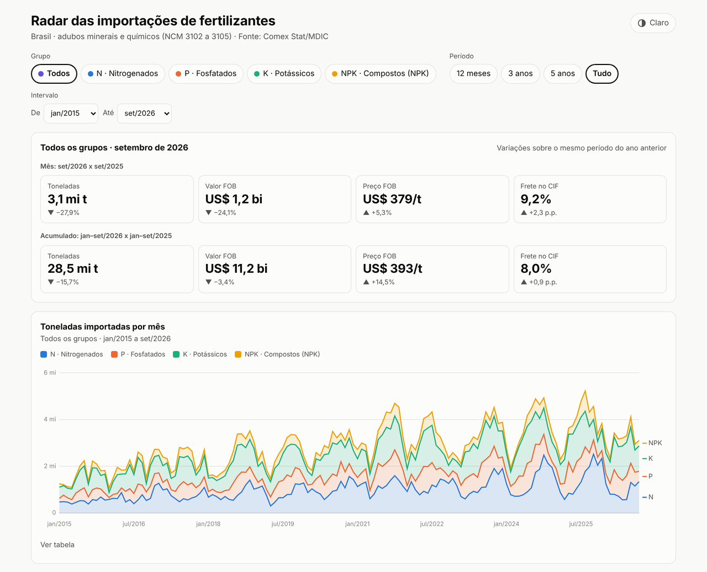

# radar-fertilizantes-br

[](https://github.com/AliceCullen-html/radar-fertilizantes-br/actions/workflows/ci.yml)

**Dashboard: [alicecullen-html.github.io/radar-fertilizantes-br](https://alicecullen-html.github.io/radar-fertilizantes-br/)**

[](https://alicecullen-html.github.io/radar-fertilizantes-br/)

Radar das importações brasileiras de fertilizantes, feito apenas com dados públicos do
[Comex Stat](https://comexstat.mdic.gov.br/), do Ministério do Desenvolvimento, Indústria,
Comércio e Serviços (MDIC).

**Fonte: Comex Stat/MDIC.**

## O que é

O Brasil importa a maior parte dos fertilizantes que usa. Este projeto baixa, mês a mês,
as importações de adubos minerais e químicos e organiza os dados para responder perguntas
como: de onde vem o potássio? Por quais portos entra a ureia? Quanto se paga, em média,
pela tonelada de MAP?

Cada linha traz país de origem, NCM, UF, via de transporte e URF (unidade da Receita
Federal onde a carga foi desembaraçada), com valor US$ FOB, peso líquido em kg, valor
US$ CIF, frete e seguro. O repositório já inclui a série de 2015-01 a 2026-09.

Para a [relação de troca](#relação-de-troca-no-porto), o projeto baixa também a
exportação mensal de soja em grão (NCM 12019000), com valor US$ FOB e peso.

### Produtos acompanhados

| Posição (SH4) | Conteúdo | Grupo |
| --- | --- | --- |
| 3102 | nitrogenados: ureia, sulfato de amônio, nitrato de amônio... | N |
| 3103 | fosfatados: superfosfatos... | P |
| 3104 | potássicos: cloreto de potássio, sulfato de potássio... | K |
| 3105 | compostos: NPK, NP, PK, NK | NPK |
| 3105 (310530 e 310540) | DAP e MAP, fosfatados pela convenção de mercado | P |

A lista completa, com 42 NCMs (inclusive códigos de versões antigas da NCM), está em
[`data/ncm_fertilizantes.csv`](data/ncm_fertilizantes.csv). Ela foi gerada a partir da
tabela auxiliar de NCM da própria API, com `python -m src.ingest --atualizar-ncm`.

## Como rodar

Requer Python 3.10 ou mais recente.

```bash
python -m venv .venv
source .venv/bin/activate        # no Windows: .venv\Scripts\activate
pip install -r requirements.txt
python -m src.ingest --inicio 2015-01   # baixa só os meses que faltam em data/raw/ e data/raw_soja/
python -m src.transform                 # gera as tabelas de data/processed/
```

A ingestão é incremental: só consulta os meses que ainda não estão no disco, uma consulta
por ano e por série (importação de fertilizantes e exportação de soja), com o mesmo cliente
e o mesmo limite de requisições. Se a API disser que publicou um mês e ele não vier em
alguma das séries, o comando termina com erro (código 1). Ao final, imprime um resumo do
período. Saída da carga de 2015-01 a 2026-09:

```text
Resumo 2015-01 a 2026-09 (Fonte: Comex Stat/MDIC)
  Linhas: 61.460 | meses: 141 | NCMs: 38
  Total: 405.882.785 t | US$ FOB 140.294.506.174 | US$ CIF 152.229.591.323
  Top 5 países de origem por kg líquido:
    1. Rússia                           90.368.607 t   22,3%
    2. China                            59.228.818 t   14,6%
    3. Canadá                           46.808.647 t   11,5%
    4. Marrocos                         24.761.403 t    6,1%
    5. Estados Unidos                   21.303.111 t    5,2%
  Top 5 URFs por kg líquido:
    1. 0917800 PORTO DE PARANAGUA              113.356.690 t   27,9%
    2. 0817800 PORTO DE SANTOS                  78.152.511 t   19,3%
    3. 1017700 PORTO DE RIO GRANDE              60.390.026 t   14,9%
    4. 0927700 PORTO DE SAO FRANCISCO DO SUL    27.426.288 t    6,8%
    5. 0727600 PORTO DE VITORIA                 23.347.338 t    5,8%
Resumo soja em grão (NCM 12019000, exportação) 2015-01 a 2026-09 (Fonte: Comex Stat/MDIC)
  Meses: 141 | Total: 988.154.583 t | US$ FOB 421.488.513.355 | US$ 427/t
```

| Opção da ingestão | O que faz |
| --- | --- |
| `--inicio AAAA-MM` | primeiro mês (a série mensal começa em 1997-01) |
| `--fim AAAA-MM` | último mês; o padrão é o último mês publicado pelo MDIC |
| `--serie todas\|fertilizantes\|soja` | série a baixar (padrão: `todas`) |
| `--ultimo-gravado` | só imprime o último mês já gravado em todas as séries, sem chamar a API |
| `--forcar` | baixa de novo meses já gravados (o MDIC pode revisar meses recentes) |
| `--atualizar-ncm` | regenera `data/ncm_fertilizantes.csv` a partir da API |
| `--pausa SEG` | pausa mínima entre chamadas à API (padrão: 10 s) |
| `--ssl-inseguro` | último recurso para problemas de certificado; veja [SSL](#ssl) |

## Dashboard (fase 3)

O [dashboard](https://alicecullen-html.github.io/radar-fertilizantes-br/) é uma página estática (`dashboard/index.html`) que lê o
`data/processed/dashboard.json`. Mostra:

- KPIs do último mês e do acumulado do ano, comparados com o mesmo período do ano anterior;
- toneladas mensais por grupo (N, P, K e NPK);
- share por país de origem e ranking de portos (URF), com variação sobre o ano anterior;
- [rotas país de origem → porto](#rotas-e-frete-por-rota): diagrama de fluxo (Sankey) por
  grupo e ano e tabela de frete US$/t das rotas com volume relevante;
- preço implícito US$/t FOB x CIF e frete US$/t;
- [relação de troca no porto](#relação-de-troca-no-porto) entre soja e KCl, ureia e MAP, com a
  média histórica como referência;
- concentração de fornecedores (HHI) por ano.

Os filtros de grupo e período valem para todos os gráficos e ficam na URL (por exemplo,
`#grupo=K&de=2021-10&ate=2026-09`), então dá para compartilhar uma visão específica. A página
funciona no celular, tem tema claro e escuro e uma tabela com os dados de cada gráfico.
O Chart.js 4.5.1 vem do jsDelivr com versão fixa e verificação de integridade (SRI).

Para ver localmente, rode `python -m http.server` na raiz do repositório e abra
<http://localhost:8000/dashboard/>.

O workflow [`pages.yml`](.github/workflows/pages.yml) publica o dashboard no GitHub Pages a
cada push na `main` que altere `dashboard/` ou o `dashboard.json` (ou manualmente, em
Actions → Pages → Run workflow). Ele não usa nenhum segredo; o único pré-requisito é, em
**Settings → Pages**, escolher **Source: GitHub Actions**.

## Dados brutos

Ficam em Parquet, particionados por ano no estilo Hive:
`data/raw/ano=AAAA/importacoes.parquet`. A coluna `ano` fica no caminho, não dentro do
arquivo.

| Coluna | Descrição |
| --- | --- |
| `mes` | mês (1 a 12) |
| `co_ncm` | NCM, 8 dígitos |
| `co_pais`, `no_pais` | país de origem: código e nome |
| `sg_uf`, `no_uf` | UF do produto (na importação, a UF do importador): sigla e nome |
| `co_via`, `no_via` | via de transporte: código e nome |
| `co_urf`, `no_urf` | URF de desembaraço: código e nome |
| `vl_fob` | valor US$ FOB |
| `kg_liquido` | peso líquido, em kg |
| `vl_cif` | valor US$ CIF (FOB + frete + seguro) |
| `vl_frete` | frete, em US$ |
| `vl_seguro` | seguro, em US$ |

Para ler todos os anos com a coluna `ano`:

```python
from src.ingest import ler_raw

df = ler_raw()
```

A exportação de soja fica em `data/raw_soja/ano=AAAA/exportacoes.parquet`, uma linha por
mês, com `mes`, `co_ncm` (12019000), `vl_fob` e `kg_liquido`. Para ler:
`from src.ingest import ler_soja`.

A série de 2015-01 a 2026-09 tem 61.460 linhas e ocupa 1,6 MB (mais 100 KB da soja), por
isso `data/raw/` e `data/raw_soja/` continuam versionados. Se passar de ~20 MB, a pasta vai para o `.gitignore` e os dados
passam a ser gerados localmente com os comandos acima. Os totais anuais de kg, US$ FOB,
US$ CIF, frete e seguro foram conferidos, até a unidade, com uma consulta agregada
independente à API, que filtra pelas posições SH4 em vez da lista de NCMs.

## Tabelas analíticas (fase 2)

`python -m src.transform` lê `data/raw/` e grava em `data/processed/`:

| Arquivo | Grão | Conteúdo |
| --- | --- | --- |
| `precos_mes_grupo_origem.csv` | mês × grupo × país | toneladas, US$ FOB, CIF e frete, e os preços implícitos em US$/t |
| `precos_mes_grupo.csv` | mês × grupo | o mesmo, somando todas as origens |
| `share_origem_ano.csv` | ano × grupo × país | toneladas, share, variação sobre o ano anterior (% e p.p.), US$/t FOB |
| `share_urf_ano.csv` | ano × grupo × URF | o mesmo, por URF |
| `hhi_ano_grupo.csv` | ano × grupo | HHI, número de origens, país líder e seu share, CR3 |
| `sazonalidade_grupo.csv` | grupo × mês | média de toneladas por mês do calendário e índice sazonal |
| `rotas_ano.csv` | ano × grupo × país × URF | [rotas](#rotas-e-frete-por-rota): toneladas, US$ FOB, CIF e frete, frete US$/t e % do CIF, share, meses com carga e se passa do corte de volume |
| `troca_mensal.csv` | mês × produto | [relação de troca](#relação-de-troca-no-porto): preço CIF do fertilizante, preço FOB da soja, t de soja por t e sacas por t |
| `dashboard.json` | — | export compacto para o dashboard: séries mensais, resumo anual, top 10 origens e URFs, rotas, sazonalidade, relação de troca |

Como os números são calculados:

- **Preço implícito:** valor total ÷ toneladas, ou seja, média ponderada pelo peso.
  Células com poucas toneladas podem ter preços extremos; use a coluna `toneladas` para
  filtrar.
- **Share:** participação nas toneladas do ano e do grupo. O grupo `TOTAL` soma N, P, K e
  NPK.
- **Variação sobre o ano anterior:** compara sempre os mesmos meses. Em 2026 (jan-set), a
  base é jan-set de 2025. Quem importou no ano anterior e parou aparece com zero.
- **HHI (Herfindahl-Hirschman):** soma dos quadrados dos shares, em %, por país de origem,
  de 0 a 10.000. Como referência, as diretrizes de fusões dos EUA (2023) consideram
  altamente concentrado um mercado com HHI acima de 1.800.
- **Sazonalidade:** média de toneladas de cada mês nos anos completos (2015 a 2025). O
  índice sazonal é a média do mês ÷ média dos 12 meses × 100.
- `n_meses` marca anos parciais. As saídas são determinísticas: os mesmos dados geram
  arquivos idênticos.

### Rotas e frete por rota

Uma rota é o par país de origem → URF de desembaraço, somado no ano (`rotas_ano.csv`). O
frete US$/t da rota é o frete total ÷ toneladas, isto é, a média ponderada pelo peso.

- **Diagrama de fluxo:** as 7 maiores origens e as 7 maiores URFs de cada ano e grupo, desde
  que tenham pelo menos 2% das toneladas; o resto entra em "Outros". A espessura é
  proporcional às toneladas. É desenhado em SVG próprio, sem biblioteca externa.
- **Corte de volume relevante:** a tabela de frete só mostra rotas com **pelo menos 50 mil t
  no ano**, cerca de um navio Supramax cheio. Num ano parcial, o corte é proporcional aos
  meses com dados (em 2026, jan-set: 37.500 t). Abaixo disso o frete por tonelada é
  ruidoso, porque vem de cargas pequenas, em contêiner, fracionadas ou até aéreas: em
  2025, o frete das rotas acima do corte ficou entre US$ 19 e 36/t (percentis 10 e 90),
  enquanto 53 das 169 rotas com menos de 5 mil t passaram de US$ 100/t, e amostras de
  poucos quilos por aeroporto passaram de US$ 10 mil/t. Mesmo assim, o corte guarda a maior
  parte do volume: em 2025, 107 das 401 rotas com carga e 93,2% das toneladas.
- O dashboard mostra as 20 maiores rotas acima do corte; todas, inclusive as abaixo dele
  (coluna `relevante`), estão no CSV.

### Relação de troca no porto

Quantas toneladas de soja exportada pagam 1 t de fertilizante importado, mês a mês
(`src/troca.py`):

```text
relação de troca = preço CIF do fertilizante (US$/t) ÷ preço FOB da soja (US$/t)
```

| Produto | NCM | Grupo |
| --- | --- | --- |
| KCl (cloreto de potássio) | 31042090 | K |
| Ureia (mais de 45% de N) | 31021010 | N |
| MAP (fosfato monoamônico) | 31054000 | P |
| Soja em grão, exceto para semeadura (exportação) | 12019000 | — |

Os NCMs foram conferidos na tabela auxiliar de NCM da API. Os preços são implícitos
(valor ÷ toneladas) do mês inteiro, e as sacas são de 60 kg. A média histórica de
referência é a média simples das relações mensais de toda a série (2015-01 em diante).

**É uma relação "no porto", não o preço ao produtor.** Compara a soja no embarque (FOB) com
o fertilizante no desembarque (CIF). Ficam de fora o frete interno nos dois sentidos,
impostos, armazenagem, margens da revenda e das tradings, prêmios de porto e o descasamento
entre a compra do adubo e a venda da safra. Serve para ver a direção e a intensidade do
poder de compra da soja frente ao adubo importado, não para orçar a compra de uma fazenda.

## Observações sobre os dados e a API

- **URF não é exatamente o porto.** É a unidade da Receita onde a mercadoria foi
  desembaraçada. Para fertilizantes, quase sempre é o porto de chegada, mas pode ser um
  porto seco ou uma unidade no interior.
- **Códigos de URF mudam com o tempo.** A Receita reorganiza suas unidades. Na série,
  `PORTO DE SAO LUIS` some e `IRF SAO LUIS` aparece; o mesmo acontece entre
  `PORTO DE ARATU` e `ALF - SALVADOR`. Em séries longas por porto, agrupe por Região
  Fiscal (os dois primeiros dígitos do código) ou revise os nomes.
- **Consultas de vários anos.** Num período como 2015-01 a 2026-09, a API soma, em cada
  ano, só os meses do intervalo (jan a set). Por isso a ingestão consulta um ano por vez.
- **Limite de requisições.** A API responde HTTP 429 a chamadas seguidas. O cliente faz
  uma pausa de 10 s entre chamadas e repete com backoff exponencial (10, 20, 40... s),
  respeitando o tempo pedido pela API.
- **Revisões.** O MDIC pode revisar meses recentes. Use `--forcar` para baixá-los de novo.
- **Códigos.** A API devolve nomes de país, UF e via. Os códigos vêm das tabelas
  auxiliares da própria API. Se um nome não for encontrado, o código fica vazio e o log
  avisa.

### SSL

A API está atrás da Cloudflare, com certificado de uma autoridade certificadora pública.
A verificação TLS fica sempre ligada, com o bundle padrão do `certifi`.

- Se a API voltar a usar a cadeia ICP-Brasil, defina `COMEXSTAT_CA_BUNDLE` com o caminho
  do arquivo da cadeia (PEM ou DER, como os publicados pelo ITI). Ele é somado ao bundle
  padrão.
- Como último recurso, `--ssl-inseguro` repete as chamadas sem verificação. Isso só
  acontece depois de uma falha de verificação e só para `api-comexstat.mdic.gov.br`,
  sempre com aviso no log.

## Desenvolvimento

```bash
pip install -r requirements-dev.txt
pre-commit install      # o gitleaks passa a bloquear commits com segredos
python -m pytest        # os testes não acessam a rede
```

O hook do gitleaks é compilado em Go; o pre-commit usa o Go instalado ou baixa um
automaticamente.

O [CI](.github/workflows/ci.yml) roda em todo push e pull request: os testes em Python
3.10 e 3.13 e o gitleaks em todo o histórico do repositório. O workflow só tem permissão
de leitura e não usa nenhum segredo. As actions estão em versões que rodam em Node 24.

Segredos nunca entram no repositório. Qualquer chave futura, como a da fase 5, é lida
apenas de variáveis de ambiente. Os nomes estão em [`.env.example`](.env.example).

## Roadmap

- [x] **Fase 1:** ingestão incremental via API do Comex Stat (`src/ingest.py`).
- [x] **Fase 2:** `src/transform.py` com preço US$/t, shares com variação anual, HHI,
  sazonalidade e o `dashboard.json`.
- [x] **Fase 3:** [dashboard estático](https://alicecullen-html.github.io/radar-fertilizantes-br/) no GitHub Pages, lendo `data/processed/dashboard.json`.
- [ ] **Fase 4:** GitHub Action mensal para atualizar os dados.
- [ ] **Fase 5:** boletim mensal com IA (opcional; a chave vem só de variável de ambiente).

## Fonte dos dados

Fonte: Comex Stat/MDIC. Portal: <https://comexstat.mdic.gov.br/>. Documentação da API:
<https://api-comexstat.mdic.gov.br/docs>. Para consultas muito grandes, o MDIC também
publica a [base de dados bruta](https://www.gov.br/mdic/pt-br/assuntos/comercio-exterior/estatisticas/base-de-dados-bruta).
